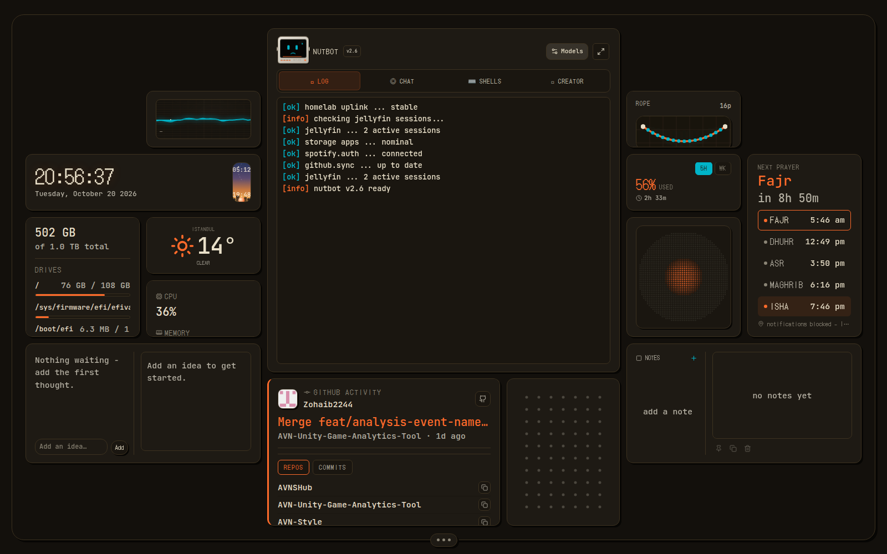
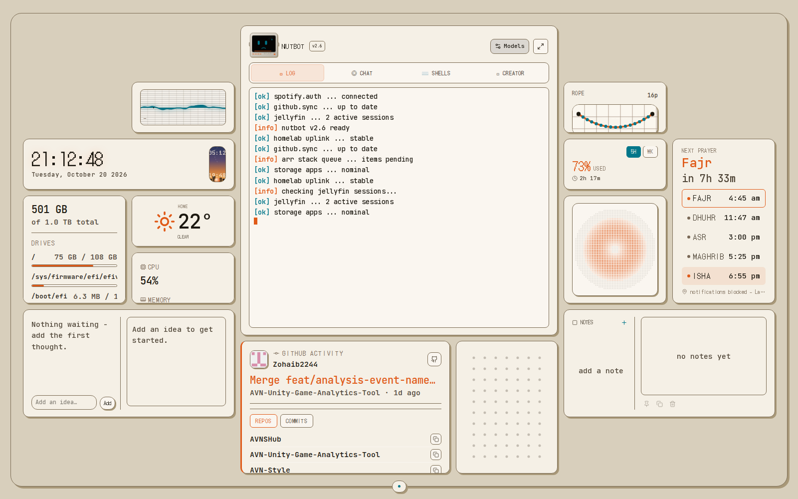
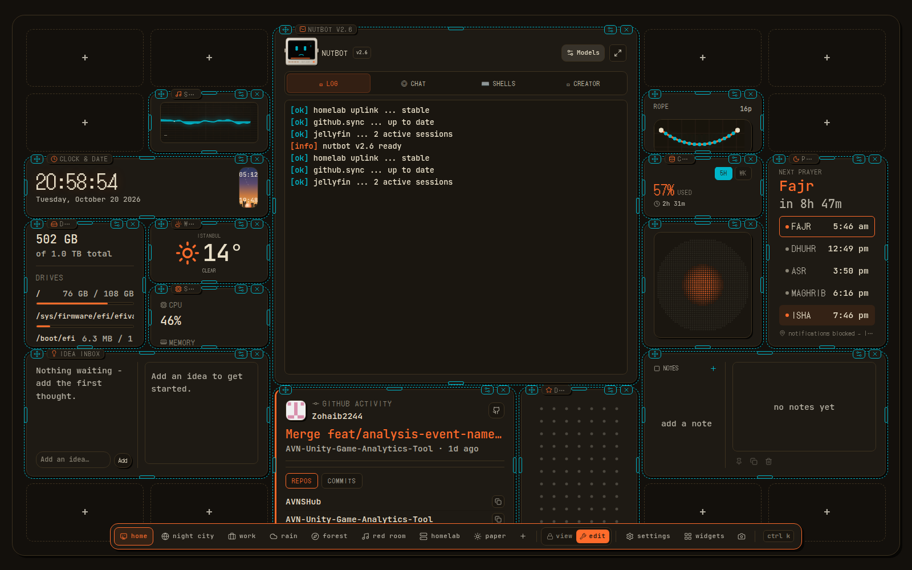
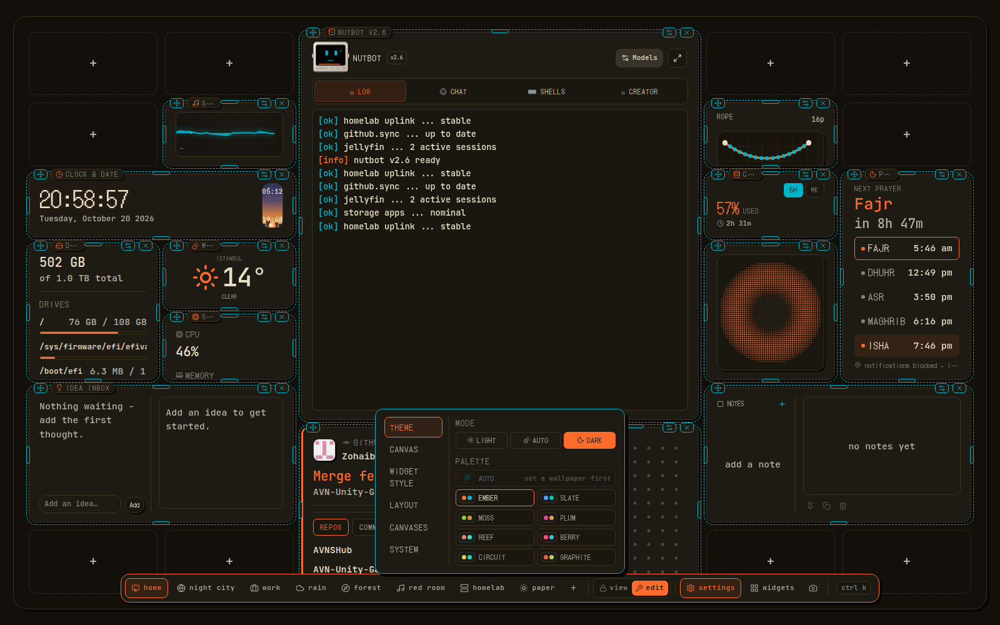
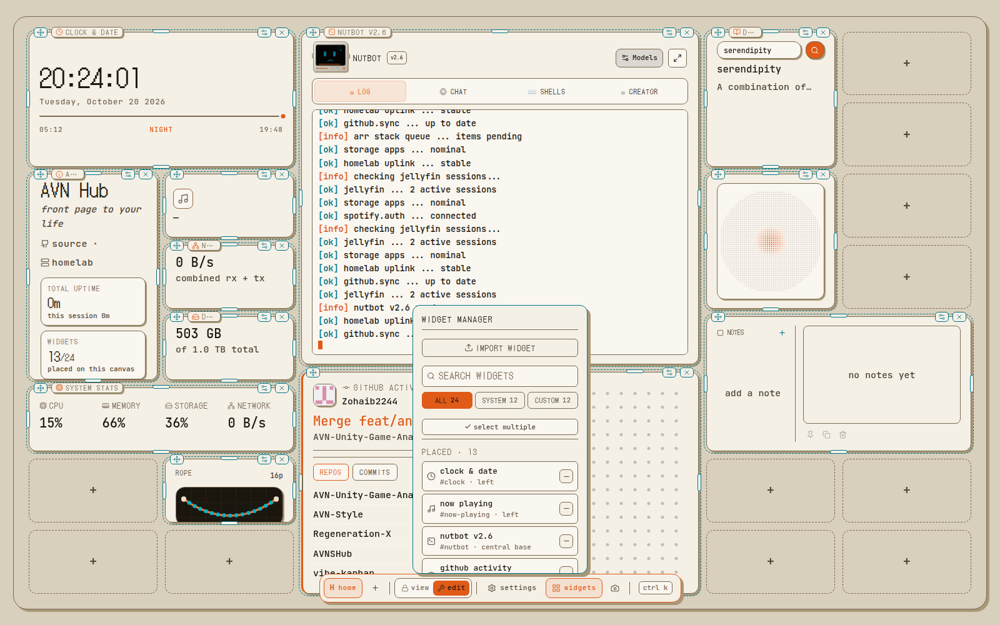

# AVN Hub

> A blank canvas. Fill it with whatever you want.

AVN Hub is a self-hosted dashboard framework that starts empty. There are no fixed widgets and no preset layout. You fill it, and the AI widget creator is the fastest way: open NutBot's creator tab, describe a widget (a cube timer, a live price feed, a rope-physics toy, a chore board), and it generates a real, type-checked `.tsx` component that drops straight onto the canvas. Then resize it, drag it around, and keep it in whichever named canvas fits: one for work, one for the homelab, one for fun.

The bundled widgets (Spotify, Steam, homelab status, system stats, GitHub activity, notes and others) are examples of what the framework holds, not the point of it.




## Quick start

```bash
git clone https://github.com/Zohaib2244/AVNSHub.git
cd AVNSHub
npm install
cp .env.example .env.local
npm run dev
```

Open http://localhost:3000. Node 20.9+ is required. On Windows, double-click `install.bat` once (it checks Node, installs packages, creates `.env.local` and sets up the database), then use `run.bat` to start the hub. The Widget Creator and NutBot chat additionally need one signed-in agent CLI (`claude`, `codex` or `opencode`); the rest of the dashboard works without it.

AVN Hub deliberately runs the Next.js dev server as its runtime, because the Widget Creator writes real source files while it runs. It has no login of its own, so keep it on localhost, a LAN or Tailscale. See [docs/SETUP.md](docs/SETUP.md).

## What you get

- **Widget Creator** - plan, ideate and build widgets from a description. A failed draft never touches your running dashboard.
- **Named canvases** - separate layouts, each with its own theme, palette, wallpaper and arrangement.
- **Slot grid** - drag and resize widgets; each size shows its own layout.
- **Hub Core** - edit mode, themes and palettes, wallpaper and backdrop modes, widget manager, layout import/export, command palette (`Ctrl+K`).
- **NutBot** - log, chat (local LLM or CLI), real shell sessions and the creator in one terminal widget.





## Docs

| Doc | For |
| --- | --- |
| [docs/SETUP.md](docs/SETUP.md) | Install, configuration, Docker, systemd, Tailscale |
| [docs/WIDGET_CREATOR.md](docs/WIDGET_CREATOR.md) | Using the in-app creator |
| [docs/WIDGETS.md](docs/WIDGETS.md) | Writing a widget by hand |
| [docs/NUTBOT.md](docs/NUTBOT.md) | Chat backends, local LLM, Work mode |
| [wallpaper/README.md](wallpaper/README.md) | Static Wallpaper Engine build |
| [docs/design/](docs/design/) | Design system and internal design notes |
| [CHANGELOG.md](CHANGELOG.md) | Release notes |

## Tech

Next.js (App Router), React, TypeScript, Tailwind CSS with CSS variables, Framer Motion, dnd-kit, Prisma + SQLite, `systeminformation`.
