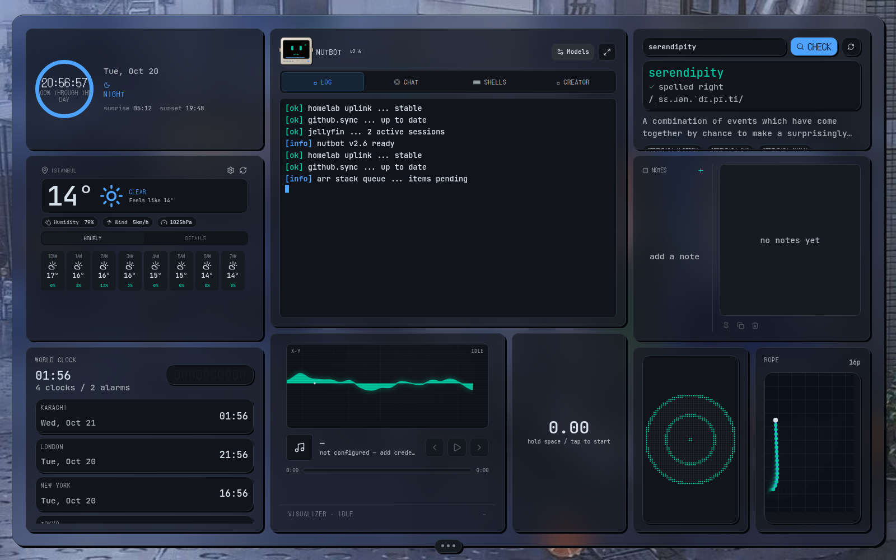
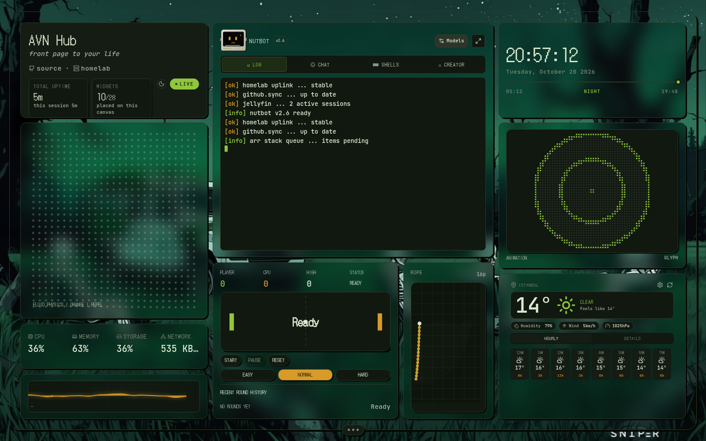
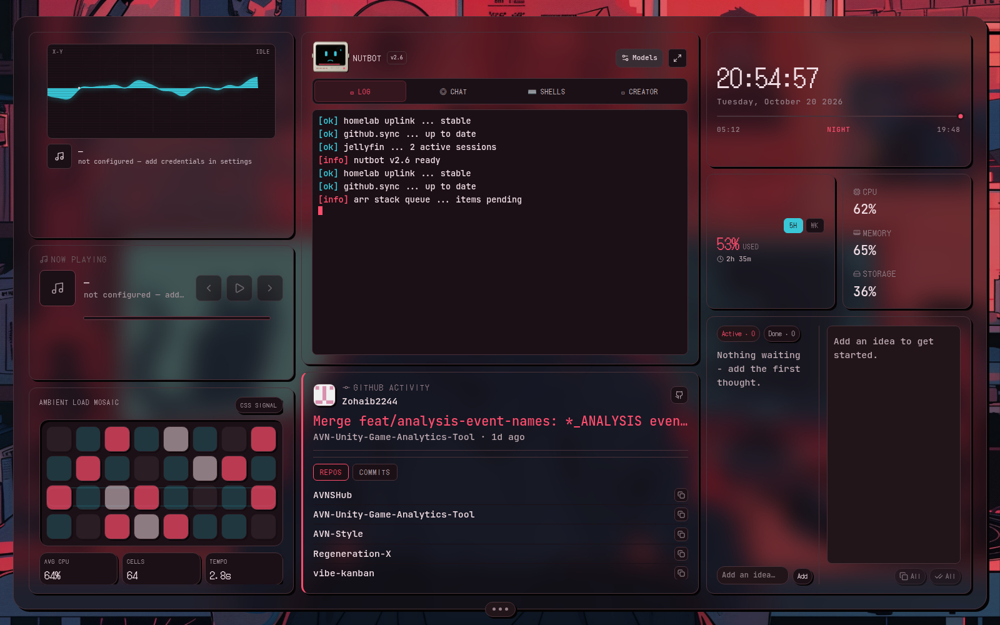
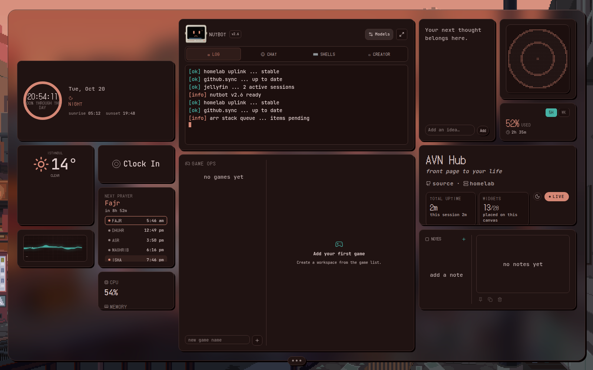

# AVN Hub

### Your space. Your widgets.

A self-hosted dashboard for your tools, live data and little distractions. Describe a widget to NutBot, watch it become a working component, then make room for it on your canvas.

[Get started](#get-started) · [Explore the gallery](docs/GALLERY.md) · [Create a widget](docs/WIDGET_CREATOR.md) · [Setup guide](docs/SETUP.md)

https://github.com/user-attachments/assets/33e770f0-70b8-48e4-9704-aacf3421e95e

## At home in light or dark

Start with the **avn-hub** arrangement: clock, weather, storage, system stats and an idea inbox beside NutBot; prayer times and visual toys on the right; GitHub activity below. Move, resize, replace — every widget is yours to change.

| Ember dark | Ember light |
| :---: | :---: |
| [](docs/screenshots/hero-dark.png) | [](docs/screenshots/hero-light.png) |

## Make it yours

One install, many moods. Each named canvas keeps its own layout, palette, wallpaper and backdrop style. Go from a quiet reading desk to a toy box, a music corner or a work console.

| Rain · a quieter desk | Forest · room to play |
| :---: | :---: |
| [](docs/GALLERY.md#rain) | [](docs/GALLERY.md#forest) |
| **Red room · music and code** | **Work · a different rhythm** |
| [](docs/GALLERY.md#red-room) | [](docs/GALLERY.md#work) |

[See all eight canvases →](docs/GALLERY.md)

## Dream up the next widget

A cube timer. A chore board. A live price feed. A tiny game. Open NutBot's **Creator** tab and describe it: plan the idea, explore visual variations, then build a real, type-checked widget. Drag it onto any canvas alongside the bundled starters.

[](docs/WIDGET_CREATOR.md)

[Walk through your first widget →](docs/WIDGET_CREATOR.md)

## Get started

```bash
git clone https://github.com/Zohaib2244/AVNSHub.git
cd AVNSHub
npm install
cp .env.example .env.local
npm run dev
```

Open **http://localhost:3000**. Requires Node 20.9+. On Windows, double-click **install.bat**, then **run.bat**. AI creation and chat need a signed-in Claude Code, Codex or OpenCode CLI.

AVN Hub runs through the dev server so generated widgets appear live. Host it on localhost, your LAN or Tailscale; it has no built-in login. [Full setup guide →](docs/SETUP.md)

## Go deeper

[Setup & hosting](docs/SETUP.md) · [Widget Creator](docs/WIDGET_CREATOR.md) · [Write a widget](docs/WIDGETS.md) · [NutBot & chat](docs/NUTBOT.md) · [Wallpaper Engine](wallpaper/README.md) · [Changelog](CHANGELOG.md)

Built with Next.js, React, TypeScript and SQLite. Styled with AVN's warm surfaces, pixel labels and chunky sticker cards.
