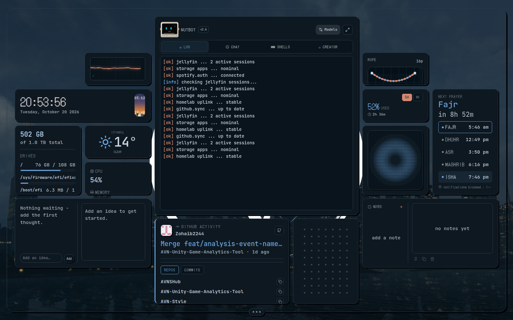
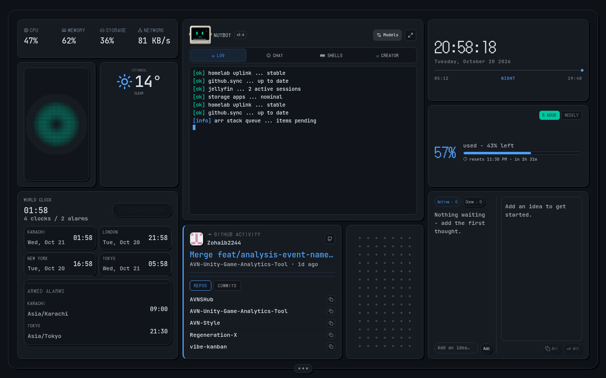
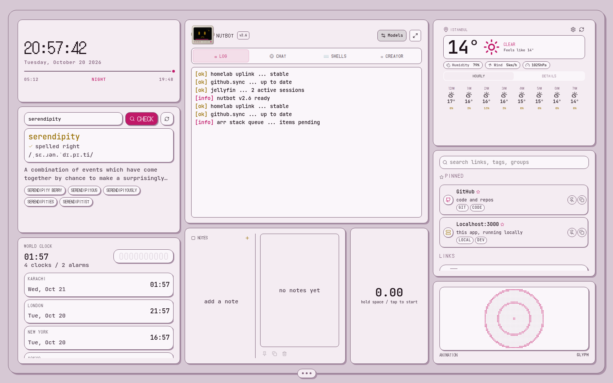

# Gallery

The same hub, dressed eight ways. Every canvas has its own widget arrangement, theme mode, palette, wallpaper and backdrop modes, so one install can hold a calm reading setup, a homelab console and a toy box side by side. All of these use only settings that ship with AVN Hub.

Where the controls are:

- **Wallpaper:** Hub Core settings > *canvas* > wallpaper (an image or a short looping video, saved per canvas).
- **Palette and mode:** settings > *theme*. Eight packs (ember, slate, moss, plum, reef, berry, circuit, graphite), each with dark and light, plus **auto**, which builds a palette from the canvas wallpaper.
- **Backdrop:** settings > *canvas* sets the canvas frame and settings > *widget style* sets the widgets. Each is one of `solid`, `blur`, `transparent` or `glass`, chosen independently.
- **Arrangement:** the deck's **edit** switch. Drag widgets to move them, pull their edges to resize, and add more from the **widgets** tab.

## Home (the default)

Ember palette, dark mode, solid canvas and widgets, no wallpaper. This is what a fresh install opens to.

The same canvas in light mode:

## Night city

The default arrangement over a city wallpaper. **Auto** palette (blue tones taken from the image), transparent canvas, solid widgets.

## Work

A work canvas: shift clock-in, game ops board, prayer times, identity card and notes. **Auto** palette from a pixel-art skyline, glass canvas, solid widgets.

## Rain

A calm reading setup: weather, world clocks, dictionary, notes, a cube timer and a rope toy. **Slate** palette, glass canvas, blurred widgets over a rainy street.

## Forest

Toys and ambience: Mini Ping-Pong, the fluid dot matrix, glyph rings and the rope sim. **Moss** palette, transparent canvas, glass widgets.

## Red room

Music and code: Spotify visualizer, now playing, the ambient load mosaic, GitHub activity and the idea inbox. **Berry** palette, blurred canvas, transparent widgets.

## Homelab

A plain console with no wallpaper: system stats, world clocks, GitHub, Claude usage and an idea inbox. **Slate** palette, dark, solid everything.

## Paper

Light mode with the **plum** palette, solid: clock, dictionary, world clocks, weather, quick links and notes.

