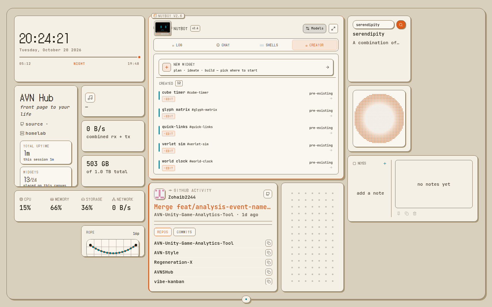

# Widget Creator

NutBot's **creator** tab builds a dashboard widget from a plain description. It writes a real `.tsx` component, type-checks it, and only then installs it. A failed draft never touches your running dashboard.

## Before you start

You need at least one signed-in agent CLI on the machine running AVN Hub: `claude`, `codex` or `opencode`. Without one the creator tab says so and stays disabled; nothing else is affected. The CLI is chosen with the pill at the top right of the terminal. Drag to reorder: if your first choice hits a rate limit, the next one is offered (after you confirm).

## Using it

1. Open NutBot, click the **creator** tab, then **new widget**.
2. Pick a starting point:
   - **Plan** - chat about a vague idea. The AI asks questions or proposes a concept card with sizes, which you can send to Build ("build this") or Ideate ("visualize first").
   - **Ideate** - generate 1-6 throwaway HTML mockups and pick one as the visual target ("finalize -> build").
   - **Build** - fill in the details and generate the real widget.

3. In Build, fill in what you know and leave the rest to the AI:
   - **Identity** - name, icon, slug (the slug becomes the widget's id, so don't change it later).
   - **Sizes and layout** - pick presets (badge, strip, column, card, panel, hero) and describe what each should show. The widget can only be resized to shapes inside the presets you choose.
   - **Data source** (optional) - a URL and the response shape, if it needs live data.
4. Describe the widget in the chat box and send. Progress streams in through `connecting -> generating -> checking types -> done`. If the type check fails, the AI gets the errors and fixes them itself.
5. When it finishes, click **install widget**, then **add to layout**. It is now a normal widget: resize it, drag it, change its settings from the gear.

Some steps (reloading the page, opening the Widget Manager because no region has room) appear as a card with a button instead of a plain message.

## Good to know

- **Editing:** use the **edit** toggle in the Build panel to pick an existing custom widget, then change its name, icon, sizes, or describe a behaviour change.
- **Failures:** the last working version is kept. If a widget on your canvas was mid-edit you may get a **restore to canvas** button.
- **Switching canvases mid-build** asks for confirmation, because it cancels the build.
- **Importing:** the same pipeline installs widgets from an exported archive.

## How it works

Each build runs in a per-widget **workbench**, a copy of the project's source outside the repo, so the agent can't write into your live tree. The agent follows the `avn-widget-build` skill, type-checks in the workbench, and the result is applied to `components/widgets/custom/<slug>/` only if it passes. Optionally a headless render checks each size preset after the build (`AVNHUB_VERIFY=off` skips it).

The skills live in `.claude/skills/` and `.agents/skills/`. They are generated from `lib/widget-creator/prompts/` by `npm run sync:widget-skill`, which also runs on `npm install` and from the in-app "regenerate skills" action. Edit the prompt sources, not the generated copies. Any `SKILL.md` you add to those folders is picked up by the matching CLI (`claude` reads `.claude/skills/`, `codex` reads `.agents/skills/`, `opencode` reads either).

To write a widget by hand instead, see [WIDGETS.md](WIDGETS.md).
